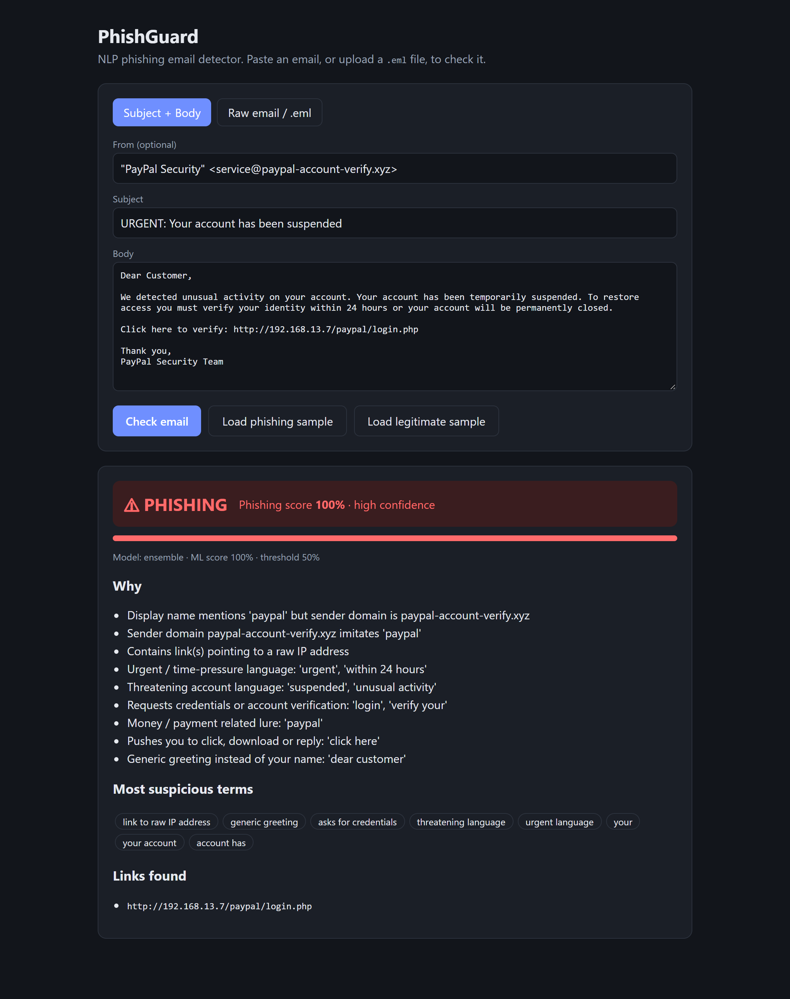

# PhishGuard: Phishing Email Detection using NLP

PhishGuard is a machine-learning system that labels emails **Phishing** or **Legitimate**. It looks at
**textual patterns** (TF-IDF n-grams), **linguistic features** (urgency, threats, credential requests,
generic greetings, capitalisation) and **email structure** (URLs, IP links, shorteners, risky TLDs,
HTML, attachments, SPF/DKIM/DMARC, Reply-To and display-name spoofing).

One detection engine serves **every email system** through a REST API and three ready-made connectors.

<p align="center">
  
</p>
<p align="center"><sub>Web UI (<code>python -m phishguard.cli serve</code>): verdict, score, reasons and suspicious terms for each email</sub></p>

```
                 ┌──────────────────────────────────────────┐
                 │        PhishGuard Detection Engine        │
                 │  MIME parser → NLP preprocessing →        │
                 │  ML model (TF-IDF+features / DistilBERT)  │
                 │  + header & link rules → score + reasons  │
                 └───────────────▲──────────────────────────┘
      ┌──────────────┬───────────┼─────────────┬───────────────────────┐
  IMAP connector  Gmail API    MS Graph       REST API / Web UI      Anything else
  Gmail, Yahoo,   connector    connector      /predict  /predict/raw (mail server filter,
  Zoho, iCloud,   coloured     Outlook        /predict/eml           browser extension,
  Outlook.com,    labels       categories                            mobile app…)
  company servers
```

## Results

### Test set: 8,249 held-out emails (10% split)

| Model | Accuracy | Precision | Recall | F1 | False-positive rate | ROC-AUC |
|---|---|---|---|---|---|---|
| Classic: TF-IDF + 30 features → Linear SVM | 99.35% | 0.9929 | 0.9938 | 0.9933 | 0.69% | 0.9997 |
| DistilBERT (fine-tuned, 2 epochs, RTX 3050) | 99.30% | 0.9933 | 0.9924 | 0.9928 | 0.64% | 0.9998 |
| **Ensemble (deployed)** | **99.48%** | **0.9951** | **0.9943** | **0.9947** | **0.48%** | **0.9999** |

The classic candidates scored validation F1 of 0.9931 (Logistic Regression), **0.9933 (Linear SVM)** and 0.9909 (XGBoost).
The model is chosen on validation F1, with a lower false-positive rate as the tie-break (`scripts/select_model.py`).

### Real-world check: 32 hand-written modern emails, not in any dataset (`scripts/realworld_eval.py`)

| Model | Trained on | Correct | Phishing caught | False alarms on legitimate mail |
|---|---|---|---|---|
| Classic | public corpora only | 23/32 | 14/16 | **7/16** |
| DistilBERT | public corpora only | 25/32 | 16/16 | **7/16** |
| Classic | + modern data | 30/32 | 15/16 | 1/16 |
| DistilBERT | + modern data | 27/32 | 15/16 | 4/16 |
| **Ensemble** | + modern data | **30/32** | **15/16** | **1/16** |

**Why the second table matters.** Trained only on the public corpora, both models scored about 99.3% on the test split,
yet flagged **7 of 16 ordinary modern emails** as phishing: Amazon shipping, Google security alerts, bank debit alerts
and an IRCTC ticket. The public legitimate class is mostly 2001–2008 corporate mail, so the models learned that
"automated + account-related" means phishing. Two fixes were added:
1. `scripts/generate_modern_emails.py` adds 8,000 modern template emails, half legitimate notifications and half
   modern phishing, using the **same brands in both classes** so the brand name is not a shortcut.
2. Sender-identity rules: an authenticated (DMARC/DKIM-aligned) sender from a well-known domain whose links stay on that domain,
   plus lookalike sender and link detection (`paypal-account-verify.xyz`, `lnstagram-help.com`).

Accuracy on the original sources stayed within ±0.3%. Baseline artefacts are kept in `reports/baseline_public_only/`.
The 32-case set is small and I wrote it myself, so treat it as a sanity check rather than a benchmark.

## Dataset

**Phishing Email Curated Datasets**, Champa et al., Zenodo [doi:10.5281/zenodo.8339691](https://zenodo.org/records/8339691), CC BY 4.0.
Six corpora were combined: **CEAS-08, Enron, Ling, Nazario, Nigerian Fraud, SpamAssassin**, for 82,486 emails. To these are
added **8,000 generated modern emails** (`Modern_Synthetic`, see above). That makes **82,489 unique emails after removing empty and
duplicate messages**, split 80/10/10 (65,991 / 8,249 / 8,249) and stratified by label and source.
Label 1 means malicious (phishing, fraud or spam) and label 0 means legitimate.

## Project layout

```
phishguard/
  email_parser.py     raw MIME / .eml → subject, body, sender, URLs, links, attachments, auth headers
  preprocessing.py    text normalisation (shared by training & inference)
  features.py         30 linguistic + structural features
  header_rules.py     SPF/DKIM/DMARC, Reply-To mismatch, brand spoofing, link-text mismatch, risky attachments
  models/classic.py   TF-IDF (word 1-2g + char 3-5g) + features pipeline, explanation
  models/transformer.py  DistilBERT inference wrapper
  detector.py         unified detector → Verdict {label, score, confidence, reasons, top_terms}
  api.py              FastAPI REST API + web UI
  cli.py              check / serve / connect
  connectors/         imap_connector.py, gmail_connector.py, outlook_connector.py
scripts/              prepare_data.py, train_classic.py, train_transformer.py, select_model.py
samples/              example .eml files
tests/                pytest suite
```

## Quick start

```bash
git clone <this-repo> && cd PhishingEmailDetector
python -m venv .venv && .venv\Scripts\activate          # Windows  (source .venv/bin/activate on Linux/macOS)
pip install -r requirements.txt                          # for GPU: install torch from pytorch.org first
```

**Use it right away:** the trained classic model (`models/classic/`, 11 MB) is in the repo, so
`python -m phishguard.cli serve` works immediately. For the full ensemble, download `phishguard-distilbert.zip` from the
**Releases** page and unzip it into `models/transformer/`. The detector falls back to the classic model when it's missing.

**Retrain from scratch:**
```bash
# 1. data: downloads the 6 Zenodo CSVs into data/raw/ + generates the modern set, then clean & split
python scripts/download_data.py
python scripts/prepare_data.py
# 2. train
python scripts/train_classic.py
python scripts/train_transformer.py --epochs 2           # needs a GPU for reasonable speed
python scripts/select_model.py                           # picks the best → models/selected_model.json
# 3. test
pytest -q
python scripts/realworld_eval.py classic transformer ensemble
```

## Using it

### Check an email from the command line
```bash
python -m phishguard.cli check samples/phishing_paypal.eml samples/legit_meeting.eml
python -m phishguard.cli check --subject "Verify your account" --body "Click http://1.2.3.4/login"
```

### REST API + web UI
```bash
python -m phishguard.cli serve --host 0.0.0.0 --port 8000
# open http://localhost:8000 for the web UI, or http://localhost:8000/docs for interactive API docs
```

| Endpoint | Input | Use |
|---|---|---|
| `POST /predict` | `{subject, body, sender?, reply_to?, headers?}` | any app that already has the fields |
| `POST /predict/batch` | `{emails: [...]}` (up to 500) | bulk scanning |
| `POST /predict/raw` | `{raw, base64?}` full RFC 822 message | mail servers, gateways |
| `POST /predict/eml` | multipart `.eml` file upload | manual checks |
| `GET /health` | | monitoring |

Example response:
```json
{ "label": "phishing", "is_phishing": true, "score": 1.0, "model_score": 0.99, "confidence": "high",
  "model_used": "ensemble",
  "reasons": ["SPF authentication failed", "Reply-To domain (mail-recovery.top) differs from sender (paypal-account-verify.xyz)",
              "Link text shows a different domain than it opens: paypal.com -> 192.168.13.7", "Urgent / time-pressure language: 'within 24 hours'"],
  "top_terms": [{"token": "verify your", "type": "phrase", "weight": 1.2}] }
```
Set `PHISHGUARD_API_KEY` to require an `X-API-Key` header.

### Connect a mailbox (automatic flagging)
Copy `.env.example` to `.env` and fill in the section for your provider.

| Provider | Command | What you see in the mailbox |
|---|---|---|
| **Any IMAP** (Gmail, Yahoo, Zoho, iCloud, Outlook.com, company servers) | `python -m phishguard.cli connect imap` | ⭐ flagged message + keyword `PhishGuard-Phishing` / `PhishGuard-Safe`. On Gmail, real labels `PhishGuard/Phishing` / `PhishGuard/Safe`. Optional move to a `Phishing` folder |
| **Gmail API** | `python -m phishguard.cli connect gmail` | red **PhishGuard/Phishing** and green **PhishGuard/Safe** labels; optional move to Spam |
| **Outlook / Microsoft 365** | `python -m phishguard.cli connect outlook` | red **PhishGuard: Phishing** and green **PhishGuard: Safe** categories, flag + high importance; optional move to Junk |

Useful flags: `--once` (single scan), `--dry-run` (score only, no changes), `--move`, `--no-safe-tag`, `--interval 60`.
Messages stay unread, and processed IDs are stored in `.state/`, so restarts don't re-scan.

**IMAP app passwords:** Gmail, Yahoo, iCloud and Outlook.com need an *app password* (with 2-step verification enabled),
not your normal password. Setup for the Gmail API and Microsoft Graph is described at the top of each connector file.

Connectors can run next to the model, or point at a central API with `PHISHGUARD_API_URL=http://server:8000`.

### Docker
```bash
docker build -t phishguard . && docker run -p 8000:8000 phishguard                  # ensemble (CPU)
docker build -t phishguard-lite --build-arg MODEL=classic .                         # ~11 MB model, no torch
```
Measured on CPU (i5-13450HX), including the explanation: **classic ≈ 13 ms per email, ensemble ≈ 19 ms per email**. No GPU is needed to serve.
`models/transformer/` is 257 MB, so commit it with Git LFS or retrain it after cloning.

## How the decision is made
1. **Parse:** MIME is decoded and HTML converted to text; URLs, anchor text/href pairs, attachments and auth headers are extracted.
2. **ML score:** the selected model (classic, DistilBERT or an ensemble) gives P(phishing) from the subject and body.
3. **Rules:** header and link checks that the training text can't see adjust the score. Examples: SPF/DKIM/DMARC fail,
   Reply-To mismatch, brand named in the display name but sent from a lookalike domain, link text pointing somewhere else, `.exe`/`.html` attachments.
4. **Verdict:** `score ≥ threshold` (default 0.5, set with `PHISHGUARD_THRESHOLD`) → **phishing**. The response includes reasons and the top contributing terms.

## Limitations
- The public corpora are mostly from 2001–2008. The generated modern set fixes the worst bias, but it is template-based.
  The 100% score on its test split only shows that the templates are learnable, not that the model generalises.
  The best improvement would be retraining on **real, recent, organisation-specific mail** (user "report phishing" clicks are ideal labels).
- QR-code phishing, image-only emails and attachment-only lures are not detected from text.
- Known misses on the real-world set: a fake job offer asking for a fee (caught by the classic model only at 0.47), a SharePoint lure
  written in neutral tone, and a Google security alert pasted **without headers** (with real headers it is trusted correctly).
- An authenticated email from a trusted domain gets a large score reduction, so phishing sent from a *compromised* trusted account is harder to catch.

## License
Code: [MIT](LICENSE). Dataset: Champa et al., *Phishing Email Curated Datasets*, Zenodo, CC BY 4.0. It is not redistributed
here; `scripts/download_data.py` fetches it from the source.
- Label 1 in Enron, Ling and SpamAssassin includes generic spam, so the model also flags aggressive marketing spam.
- Header rules are heuristics. Tune their weights in `header_rules.py` for your environment. 
